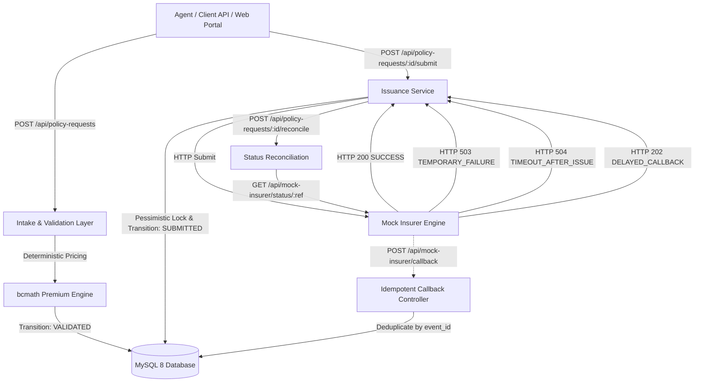
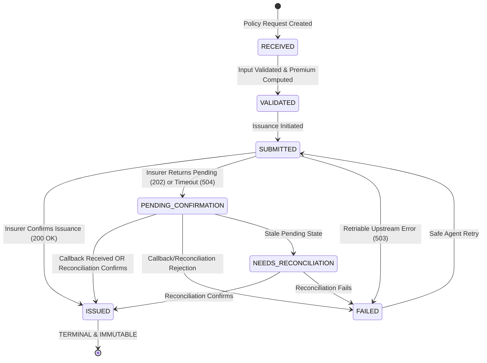
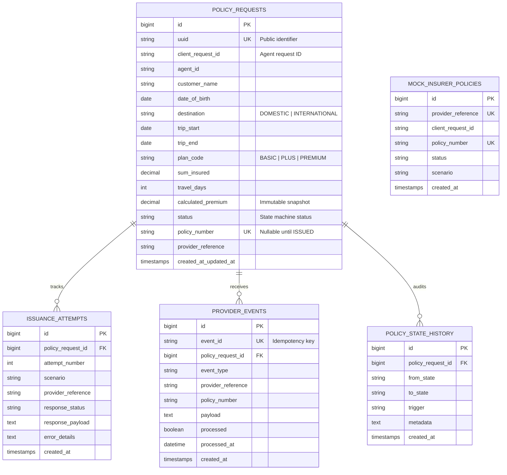

# PolicyFlow — Fault-Tolerant Insurance Issuance & Reconciliation Engine

> **Candidate Assignment • Version 1.0**  
> Built with **Laravel 11**, **PHP 8.2+**, **MySQL 8+**, and **Decimal-Safe `bcmath` Arithmetic**.

---

## 1. Overview & Business Problem

PolicyFlow is a resilient insurance issuance and reconciliation engine designed for travel-insurance distribution. In an environment where external insurers are inherently unreliable—subject to network timeouts, delayed callbacks, duplicate webhooks, and gateway outages—PolicyFlow provides **fault-tolerant operational visibility**, **guaranteed duplicate prevention**, and **deterministic lifecycle state management**.

### Core Engineering Objectives
- **Zero Duplicate Issuances**: Enforce strict uniqueness at both the database and application levels.
- **State Machine Integrity**: Prevent invalid state regressions (e.g., an `ISSUED` policy is terminal and can never be altered or re-submitted).
- **Decimal-Safe Financial Arithmetic**: 100% `bcmath` mathematical computations to eliminate binary floating-point drift.
- **Comprehensive Operational Audit Trail**: Full visibility into state transitions, insurer submission attempts, and incoming provider webhooks.
- **End-to-End Reliability**: Automated protections against duplicate intake, network timeouts, duplicate callbacks, and retries.

---

## 2. System Architecture

### High-Level Data Flow



---

## 3. State Machine & Transition Rules

Policy requests progress through a strict finite state machine. Every transition is atomically recorded in `policy_state_history` with its trigger and contextual metadata.



### Transition Matrix

| From State | Allowed Target States | Behavior on Invalid Transition |
|------------|-----------------------|--------------------------------|
| `RECEIVED` | `VALIDATED`, `FAILED` | Throws `IllegalStateTransitionException` (422) |
| `VALIDATED` | `SUBMITTED` | Throws `IllegalStateTransitionException` (422) |
| `SUBMITTED` | `ISSUED`, `PENDING_CONFIRMATION`, `FAILED` | Throws `IllegalStateTransitionException` (422) |
| `PENDING_CONFIRMATION` | `ISSUED`, `FAILED`, `NEEDS_RECONCILIATION` | Throws `IllegalStateTransitionException` (422) |
| `FAILED` | `SUBMITTED` (Safe Retry) | Throws `IllegalStateTransitionException` (422) |
| `NEEDS_RECONCILIATION` | `ISSUED`, `FAILED`, `SUBMITTED` | Throws `IllegalStateTransitionException` (422) |
| **`ISSUED`** | **None (Terminal)** | **Permanently immutable. Re-submissions short-circuited.** |

---

## 4. Deterministic Pricing Engine (`PremiumCalculator`)

Implemented using PHP's **`bcmath` extension** with scale 4 and standard half-up rounding to 2 decimal places.

### Formula

```text
premium = base_daily_rate × travel_days × age_multiplier × destination_multiplier × coverage_multiplier
```

### Pricing Rules Matrix

| Dimension | Option | Multiplier / Base Value |
|-----------|--------|-------------------------|
| **Plan Code** | `BASIC` | ₹12.00 / day |
| | `PLUS` | ₹20.00 / day |
| | `PREMIUM` | ₹30.00 / day |
| **Customer Age** *(at trip start)* | 0 – 17 | 1.10x |
| | 18 – 60 | 1.00x |
| | 61 – 70 | 1.50x |
| | 71+ | 2.00x |
| **Destination** | `DOMESTIC` | 1.00x |
| | `INTERNATIONAL` | 1.80x |
| **Sum Insured** | ₹100,000 | 1.00x |
| | ₹300,000 | 1.25x |
| | ₹500,000 | 1.50x |
| **Travel Days** | Inclusive | `trip_end - trip_start + 1` (minimum 1) |

### Specification Example Verification
- **Input**: `client_request_id`: `AGT-2026-0001`, `agent_id`: `AGENT-17`, DOB: `1998-04-10`, `destination`: `INTERNATIONAL`, `trip_start`: `2026-11-10`, `trip_end`: `2026-11-14`, `plan_code`: `PLUS`, `sum_insured`: `300000`.
- **Breakdown**:
  - `travel_days` = 5 days
  - `age` = 28 years (bracket 18–60 → multiplier 1.00)
  - `base_daily_rate` = ₹20.00
  - `destination_multiplier` = 1.80
  - `coverage_multiplier` = 1.25
  - **Calculated Premium**: `20 × 5 × 1.00 × 1.80 × 1.25` = **₹225.00** (Verified in automated unit test `PremiumCalculatorTest`).

---

## 5. The Four Reliability Guarantees

The candidate assignment requires implementing at least two reliability cases. **PolicyFlow implements and tests all four:**

### Case 1: Duplicate Intake (Near-Simultaneous Submissions)
- **Problem**: An agent's system retries or submits requests concurrently with the same `(agent_id, client_request_id)`.
- **Solution**:
  1. MySQL composite unique index: `unique(['agent_id', 'client_request_id'])`.
  2. Pre-check queries existing records and returns HTTP 200 with `is_duplicate: true`.
  3. If near-simultaneous concurrent requests bypass the application check, the database constraint raises error `1062` / `23000`. `PolicyRequestController` catches this exception, loads the surviving record, and returns HTTP 200.
  4. Guarantees exactly **one** logical policy record is ever created.

### Case 2: Timeout After Success (Reconciliation Before Re-Issue)
- **Problem**: Insurer successfully issues a policy, but the client HTTP connection drops or times out (HTTP 504). Blindly re-issuing would cause duplicate policies.
- **Solution**:
  1. On timeout, state transitions to `PENDING_CONFIRMATION` and provider reference is preserved.
  2. Before any re-submission, `IssuanceService` executes `reconcile()` against `GET /api/mock-insurer/status/{ref}`.
  3. If the insurer confirms the policy was issued internally, PolicyFlow adopts the provider's `policy_number` and transitions directly to `ISSUED`.

### Case 3: Duplicate Provider Callbacks (Idempotent Webhooks)
- **Problem**: Unreliable insurer webhook deliveries fire identical events 2–3 times.
- **Solution**:
  1. Database unique index on `provider_events.event_id`.
  2. Incoming events are locked and deduplicated. If an `event_id` is already recorded, the controller immediately returns HTTP 200 with `is_duplicate: true`.
  3. Row-level pessimistic locking (`lockForUpdate`) ensures state transitions execute once.

### Case 4: Safe Retries After Temporary Failure
- **Problem**: Insurer returns a retriable failure (HTTP 503). Retrying must not generate duplicate policies or alter accepted financial terms.
- **Solution**:
  1. State transitions: `VALIDATED → SUBMITTED → FAILED → SUBMITTED → ISSUED`.
  2. Each attempt is logged in `issuance_attempts` with attempt count, scenario, response code, and error payload.
  3. Original `calculated_premium` snapshot is strictly preserved across all retry attempts.

---

## 6. Database Schema (MySQL 8)



---

## 7. API Reference

All endpoints return JSON and use standard HTTP status codes.

| Method | Endpoint | Description | Status Codes |
|--------|----------|-------------|--------------|
| `POST` | `/api/policy-requests` | Intake policy request (idempotent) | `201 Created` (new), `200 OK` (duplicate), `422 Unprocessable` |
| `GET` | `/api/policy-requests` | List policy requests (filters + pagination) | `200 OK` |
| `GET` | `/api/policy-requests/{id}` | Retrieve request details & audit trail | `200 OK`, `404 Not Found` |
| `POST` | `/api/policy-requests/{id}/submit` | Submit or retry issuance with insurer | `200 OK`, `422 Unprocessable` |
| `POST` | `/api/policy-requests/{id}/reconcile` | Reconcile policy status against insurer | `200 OK`, `404 Not Found` |
| `POST` | `/api/mock-insurer/submit` | Mock insurer submission endpoint | `200 OK`, `202 Accepted`, `503 Service Unavailable`, `504 Timeout` |
| `GET` | `/api/mock-insurer/status/{ref}` | Provider status lookup for reconciliation | `200 OK`, `404 Not Found` |
| `POST` | `/api/mock-insurer/callback` | Receive provider callback (idempotent) | `200 OK` |
| `POST` | `/api/mock-insurer/trigger-callback` | Simulate asynchronous webhook emission | `200 OK` |

---

## 8. Setup & Running Locally

### Prerequisites
- **PHP 8.2+** with extensions: `pdo_mysql`, `bcmath`, `mbstring`, `openssl`, `curl`
- **Composer 2.x**
- **MySQL 8.0+** running locally (e.g., localhost:3306)

### 1. Clone & Configure
```bash
git clone <repository-url> policyflow
cd policyflow
cp .env.example .env
```

Verify your `.env` contains your MySQL credentials:
```ini
DB_CONNECTION=mysql
DB_HOST=127.0.0.1
DB_PORT=3306
DB_DATABASE=policyflow
DB_USERNAME=root
DB_PASSWORD=your_password
```

### 2. Install Dependencies & Migrate
```bash
composer install
php artisan key:generate
php artisan migrate --seed
```

### 3. Start Application
```bash
php artisan serve
```
Open your browser to:
- **Operational Dashboard**: [http://127.0.0.1:8000](http://127.0.0.1:8000)
- **New Policy Intake & Live Pricing**: [http://127.0.0.1:8000/policies/create](http://127.0.0.1:8000/policies/create)
- **Interactive Reliability Sandbox**: [http://127.0.0.1:8000/sandbox](http://127.0.0.1:8000/sandbox)

---

## 9. Automated Testing

Run the full automated test suite using PHPUnit / Artisan:

```bash
php artisan test
```

### Test Suite Summary (36 Tests • 168 Assertions • 100% Pass)
- `PremiumCalculatorTest`: Verifies pricing formula against specification example (₹225.00), age brackets, destination multipliers, and input validation.
- `PolicyStateMachineTest`: Verifies allowed transitions, illegal transition rejections, and permanent immutability of `ISSUED` state.
- `PolicyRequestIntakeTest`: Verifies 201 vs 200 HTTP codes, field validations, date logic (`trip_end >= trip_start`), and audit logging.
- `IssuanceWorkflowTest`: Verifies submission lifecycle, attempt logging, unique policy numbering, and delayed callback flows.
- `ReliabilityTest`: Comprehensive feature tests for all 4 reliability cases (duplicate intake, timeout reconciliation, duplicate callback deduplication, safe retry).
- `DashboardWebTest`: Verifies web routes, live preview calculation, and operational dashboard views.

---

## 10. License

Open-source software under the [MIT license](LICENSE).
